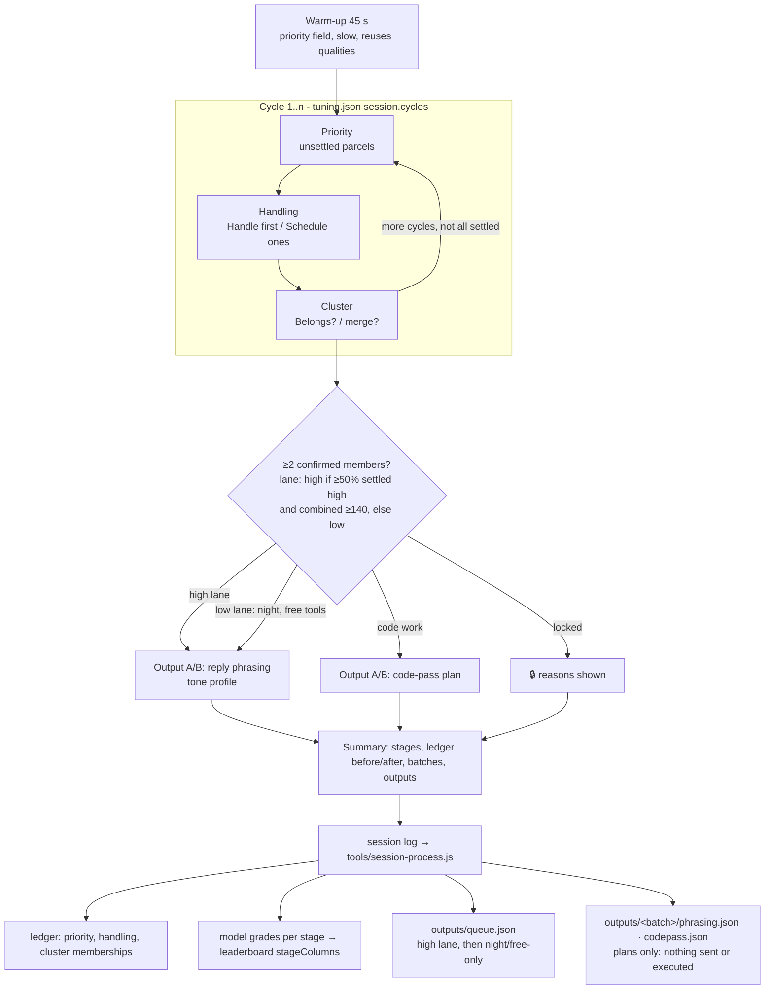

# Parcel Panic · chained session (`?mode=session`, game 0.5.0)

One sitting chains the evaluation stages so related work is processed together. Sim: `?mode=session&sim=1&fast=16`.

## Stage registry (`stages.js`)
`ParcelStages.register(id, def)`: wave stages (`warmup`, `priority`, `handling`), an overlay stage (`cluster`) and output stages
(`phrasing`, `codepass`). `plan(tuning)` expands `session.chain` × `session.cycles` into steps; add a stage by registering it and
naming it in `tuning.json → session.chain`.

## Pipeline on the box
1. `tools/next-round.js` builds round N (parcels, priority + handling labels).
2. `tools/session-prep.js --round round-N` asks each Ollama model for clusters (label, rationale, work type, members); clusters with
   Jaccard ≥ 0.6 merge. For the top 3 it writes guided/terse reply phrasings (tone style guide) and code-pass plans for code work.
   Written to `round.session`.
3. He plays `?mode=session`; the log goes to `logs/human/`.
4. `tools/session-process.js --log <file>` → ledger (+ cluster evals, 3 same answers in a row = membership settled), model grades
   (cluster precision = share of its proposed memberships he confirmed; phrasing/codepass = A/B win rate), `outputs/<batch>/`,
   per-stage columns in `data/model-scores.json → stageColumns`. Then next-round for the following round.
   `--sim` writes only `*.sim.json` and `outputs/sim/`.

## Unlock and lanes (`tuning.json → session.batch`)
A cluster becomes a batch once ≥ `minMembers` (2) members are confirmed (3 consistent answers, or confirmed this session). Its lane:
**high** if ≥ `minSettledHighShare` (50 %) of confirmed members are settled in Handle first/Schedule and combined priority ≥
`combinedPriorityThreshold` (140), existing tiers allowed; otherwise **low**: night queue, free tools only (local Ollama / OpenCode
free), lowest precedence, processed only when higher night work runs out. Low-lane batches still get phrasing picks (marked 🌙) and
code plans filtered to free-tier steps. The ordered plan is `outputs/queue.json` (see outputs/QUEUE.md); nothing executes.
A SIM round can carry `session.seededUnlock` with lowered thresholds to demo the high lane; it is labelled SIM everywhere.
